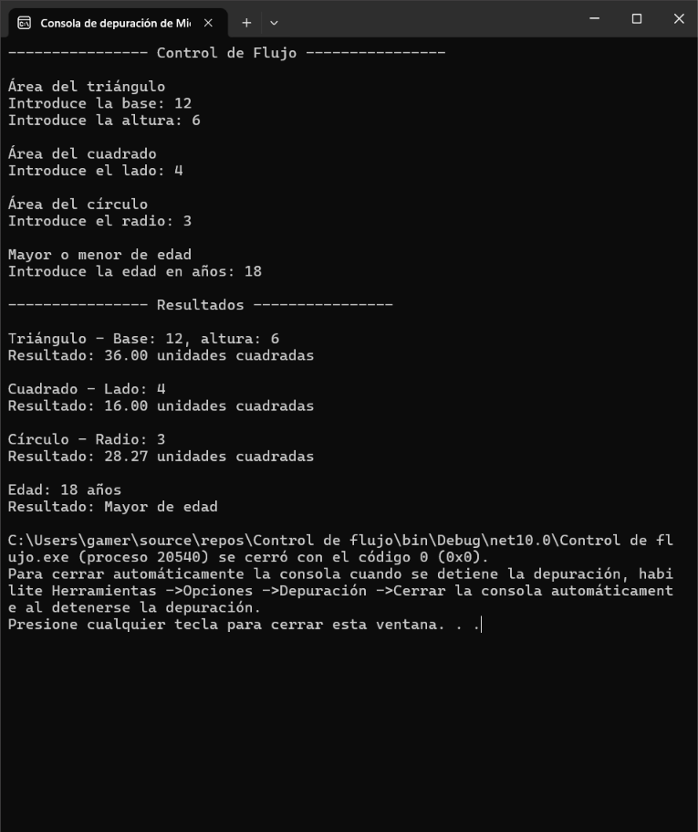
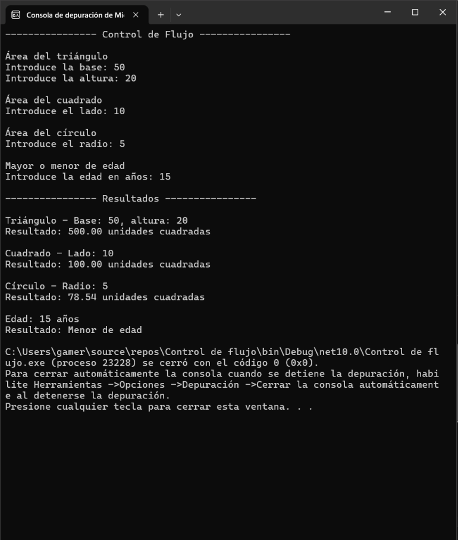

Asignatura: Algoritmos Computacionales  
Profesor: Gamalier Reyes del Carmen  
Lenguaje: C#  
Tipo de aplicación: Consola

Integrantes

| Nombre | Matrícula |

| Jhesmi Malvelis Alcántara | 26-2-EISN-021 |
| Alexander Rodriguez | 26-EISN-2-010 |
| Genny Yunior Sánchez Tavarez | 26-EISN-2-030 |
| Jonathan Sanchez | 26-EISN-2-041 |
| Oreily Esther Daniel Ramos | 26-EISN-2-029 |

Descripción

Aplicación de consola desarrollada en C# que calcula las áreas
de un triángulo, un cuadrado y un círculo. También recibe la
edad de una persona e indica si es mayor o menor de edad.

El programa solicita los datos por teclado, valida las entradas
e invoca funciones que reciben parámetros y retornan resultados.

Datos de entrada

- Base y altura del triángulo.
- Longitud del lado del cuadrado.
- Radio del círculo.
- Edad de la persona en años enteros.

Las medidas deben ser números finitos mayores que cero.
La edad debe ser un número entero no negativo.
Procesamiento de los datos

| Función | Procesamiento |

| Atriangulo | Calcula el área mediante (base × altura) / 2. |
| ACuadrado | Calcula el área mediante lado × lado. |
| ACirculo | Calcula el área mediante Math.PI × radio². |
| CheckIfYoung | Compara la edad con 18 y retorna el mensaje correspondiente. |
| LeerMedida | Solicita y valida una medida numérica positiva. |
| LeerEdad | Solicita y valida una edad entera no negativa. |

Para validar las entradas se utilizan double.TryParse,
double.IsFinite e int.TryParse. Si el dato no es válido,
un bucle solicita que se introduzca nuevamente.

Datos de salida

- Área del triángulo en unidades cuadradas.
- Área del cuadrado en unidades cuadradas.
- Área del círculo en unidades cuadradas.
- Mensaje «Mayor de edad» cuando la edad es mayor o igual a 18.
- Mensaje «Menor de edad» cuando la edad es menor que 18.

Las áreas se muestran con dos posiciones decimales.

Organización del código

El archivo Program.cs está dividido mediante comentarios
en cuatro partes:

1. Presentación y entrada de datos.
2. Llamadas a las funciones y presentación de resultados.
3. Funciones de cálculo y clasificación de edad.
4. Lectura y validación de datos.

Cómo ejecutar

Desde Visual Studio Community

1. Tener instalado el SDK de .NET correspondiente al proyecto.
   El proyecto está configurado para .NET 10.
2. Descargar o clonar el repositorio.
3. Abrir el archivo control-de-flujo.csproj.
4. Presionar Ctrl + F5.
5. Introducir los valores solicitados en la consola.

Desde una terminal

Con el SDK de .NET 10 instalado, ejecutar:

bash
git clone https://github.com/mapas48a/control-de-flujo.git
cd control-de-flujo
dotnet run

Ejemplos de prueba

| Dato o resultado | Escenario 1 | Escenario 2 |

| Base del triángulo | 50 | 12 |
| Altura del triángulo | 20 | 6 |
| Lado del cuadrado | 10 | 4 |
| Radio del círculo | 5 | 3 |
| Edad | 15 | 18 |
| Área del triángulo | 500.00 | 36.00 |
| Área del cuadrado | 100.00 | 16.00 |
| Área del círculo | 78.54 | 28.27 |
| Clasificación | Menor de edad | Mayor de edad |

El separador decimal puede variar según la configuración
regional del equipo.

Capturas del programa en ejecución

Escenario 1: persona menor de edad

Escenario 2: persona mayor de edad

